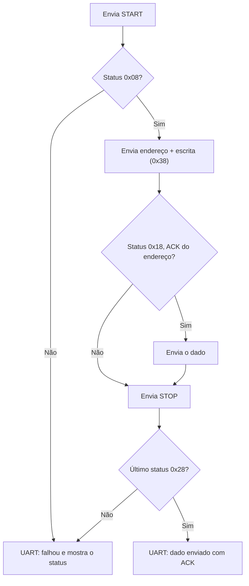
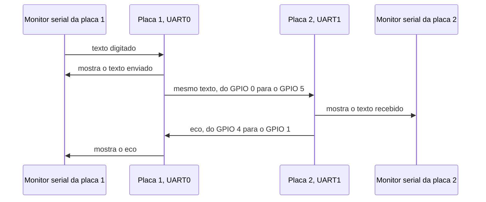
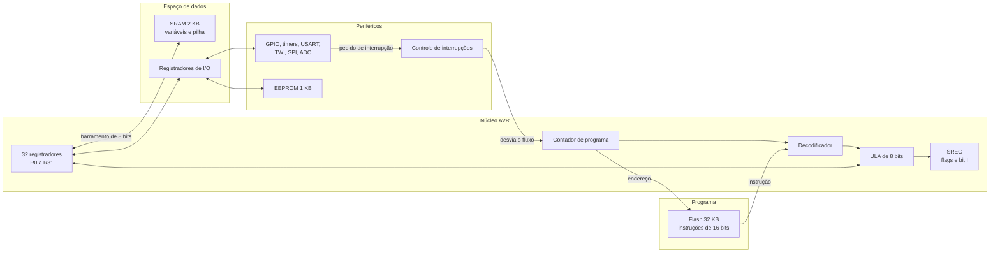

# Microcontroladores AVR

Sketches de estudo que programam o ATmega328P, o microcontrolador do Arduino Uno, direto nos registradores do chip, além de testes de comunicação serial e Ethernet numa placa com RP2040. Este documento é para quem quer avaliar ou reproduzir esse trabalho: explica o que cada pasta faz, como gravar os sketches e o que deve aparecer ao rodá-los. A segunda metade é um material de teoria sobre a arquitetura AVR, com contas e exemplos ligados ao código do repositório.

## Índice

- [Visão geral](#visão-geral)
- [O que tem em cada pasta](#o-que-tem-em-cada-pasta)
- [Destaques](#destaques)
  - [Registradores do ATmega328P](#registradores-do-atmega328p)
  - [I2C por registradores com verificação de status](#i2c-por-registradores-com-verificação-de-status)
  - [Ponte serial entre duas placas RP2040](#ponte-serial-entre-duas-placas-rp2040)
  - [Ethernet com W5100 e W5100S](#ethernet-com-w5100-e-w5100s)
- [Como compilar e gravar](#como-compilar-e-gravar)
- [Como verificar se deu certo](#como-verificar-se-deu-certo)
- [Limitações conhecidas](#limitações-conhecidas)
- [Teoria avançada de microcontroladores AVR](#teoria-avançada-de-microcontroladores-avr)
  - [Arquitetura do núcleo AVR](#arquitetura-do-núcleo-avr)
  - [Mapa de memória do ATmega328P](#mapa-de-memória-do-atmega328p)
  - [GPIO no nível do registrador](#gpio-no-nível-do-registrador)
  - [Interrupções](#interrupções)
  - [Timers e PWM](#timers-e-pwm)
  - [USART e erro de baud rate](#usart-e-erro-de-baud-rate)
  - [TWI (I2C)](#twi-i2c)
  - [SPI](#spi)
  - [EEPROM e desgaste](#eeprom-e-desgaste)
  - [ADC](#adc)
  - [Clock, fuses, reset e watchdog](#clock-fuses-reset-e-watchdog)
  - [Modos de economia de energia](#modos-de-economia-de-energia)
  - [Registradores ou API Arduino](#registradores-ou-api-arduino)
  - [AVR e RP2040 lado a lado](#avr-e-rp2040-lado-a-lado)
- [Referências](#referências)
- [Licença](#licença)

## Visão geral

Num microcontrolador, um registrador de periférico é um endereço de memória que controla o hardware: escrever um bit nele liga um pino, inicia um timer ou envia um byte. A API do Arduino esconde esses registradores atrás de funções como `pinMode()` e `digitalWrite()`. Os sketches de [Registradores AVR/](Registradores%20AVR/) e de [I2C/sketch_sep11a/](I2C/sketch_sep11a/) fazem o caminho contrário e configuram tudo à mão, a partir do datasheet do ATmega328P. Um exemplo é `DDRB = 0b00110000;`, que define quais pinos da porta B são saídas.

Apesar do nome do repositório, os testes de UART e de Ethernet rodam em outra plataforma: a WIZnet W5100S-EVB-Pico, que junta o microcontrolador RP2040 (o mesmo do Raspberry Pi Pico) ao chip Ethernet W5100S. A seção [AVR e RP2040 lado a lado](#avr-e-rp2040-lado-a-lado) compara as duas arquiteturas.

O que o repositório mostra na prática:

- configuração de periféricos bit a bit, a partir do datasheet;
- interrupções por mudança de pino e por estouro de timer, com o cálculo do valor de recarga;
- o protocolo I2C tratado como máquina de estados no periférico TWI, conferindo o código de status de cada etapa;
- comunicação serial entre duas placas e servidores TCP (telnet e HTTP) sobre Ethernet.

## O que tem em cada pasta

Cada pasta com um arquivo `.ino` é um sketch independente. A coluna "Origem" separa o código autoral dos exemplos de terceiros usados como base.

| Pasta | Placa | O que faz | Origem |
| --- | --- | --- | --- |
| [Registradores AVR/main](Registradores%20AVR/main/) | ATmega328P | GPIO por `DDRB`/`PORTB`/`PINB`, interrupção por mudança de pino e estouro do Timer2 | Autoral |
| [Registradores AVR/timer](Registradores%20AVR/timer/) | ATmega328P | Timer1 gerando uma base de tempo de 1 ms | Autoral |
| [Registradores AVR/EEPROM](Registradores%20AVR/EEPROM/) | ATmega328P | Grava na EEPROM o byte recebido pela serial e lê de volta | Autoral |
| [teste blink](teste%20blink/) | ATmega328P | Pisca a saída PB7 por registradores | Autoral |
| [I2C/sketch_sep11a](I2C/sketch_sep11a/) | ATmega328P | Escrita I2C feita no TWI por registradores, com o resultado enviado pela UART | Autoral, com cabeçalhos de UART e I2C adaptados pelo prof. Rodrigo Rech |
| [I2C/I2C_scanner](I2C/I2C_scanner/) | Qualquer placa Arduino | Procura dispositivos nos endereços I2C de 1 a 126 | Código público do fórum Arduino |
| [display i2c/ada fruit](display%20i2c/ada%20fruit/) | Qualquer placa Arduino | Texto em displays OLED SSD1306 de 128×64 e 128×32 | Autoral, com a biblioteca Adafruit SSD1306 |
| [display i2c/TesteDisplay](display%20i2c/TesteDisplay/) | Placas AVR | LCD 16×2 com módulo I2C (PCF8574) | Exemplo do canal BrincandoComIdeias |
| [display i2c/Nova pasta](display%20i2c/Nova%20pasta/) | Raspberry Pi Pico | LCD 16×2 por I2C em C puro, com o pico-sdk; não é um sketch Arduino | Exemplo oficial do pico-sdk |
| [teste UART](teste%20UART/) | W5100S-EVB-Pico | Testes de UART em versões sucessivas, até uma ponte serial entre duas placas | Autoral (a V1.1 é de João) |
| [Ethernet/Ethernet ipv4](Ethernet/Ethernet%20ipv4/) | W5100S-EVB-Pico | Servidor de chat telnet e servidor de eco | Exemplo AdvancedChatServer da biblioteca Ethernet; a V1.1 é uma modificação autoral |
| [Ethernet/web](Ethernet/web/) | Arduino com shield W5100 | Página web que liga e desliga um LED | Tutorial da MasterWalker Shop |

A biblioteca [display i2c/LiquidCrystal_I2C/](display%20i2c/LiquidCrystal_I2C/), versão 1.1.2, está copiada no repositório junto com o [.zip](display%20i2c/LiquidCrystal_I2C.zip) de instalação.

## Destaques

### Registradores do ATmega328P

[Registradores AVR/main/main.ino](Registradores%20AVR/main/main.ino) reúne três recursos num sketch só:

- **GPIO.** `DDRB = 0b00110000` deixa PB4 e PB5 como saídas e o resto da porta B como entrada, e `PORTB = 0b00000001` liga o resistor de pull-up interno do PB0. O `loop()` lê o PB3 pelo `PINB` e inverte o PB5, ligado ao LED do Uno no pino D13, com `PORTB ^= 0b00100000`.
- **Interrupção por mudança de pino.** `PCICR = 0b00000001` habilita o grupo PCINT0 a PCINT7 (a porta B), e `PCMSK0 = 0b00000010` escolhe só o PB1, que é o pino D9. A rotina `ISR(PCINT0_vect)` roda nas duas bordas, então ela lê o `PINB` para saber se o pino foi a 0 ou a 1.
- **Timer2 em modo normal.** Com prescaler 1024 (`TCCR2B = 0b00000111`), a rotina de estouro recarrega o `TCNT2` para que cada estouro dure cerca de 10 ms.

O valor de recarga sai da fórmula escrita no próprio sketch, com o clock de 20 MHz definido em `CLOCK`:

- recarga = 256 − (0,01 s × 20.000.000 Hz ÷ 1024) = 256 − 195,3 = 60,7, que vira 60 ao ser guardado numa variável inteira;
- duração de cada estouro = (256 − 60) × 1024 ÷ 20.000.000 Hz = 10,04 ms;
- a rotina imprime `estouro` a cada 37 estouros, ou seja, a cada 37 × 10,04 ms ≈ 371 ms. O comentário do sketch fala em 1 s, o que exigiria 100 estouros (100 × 10,04 ms ≈ 1,004 s).

[Registradores AVR/timer/main/main.ino](Registradores%20AVR/timer/main/main.ino) aplica a mesma ideia ao Timer1, que tem 16 bits, com clock de 16 MHz e prescaler 64 (`TCCR1B = 0b00000011`). Cada contagem dura 64 ÷ 16.000.000 Hz = 4 µs. A recarga 65536 − 250 = 65286 deixa 250 contagens até o estouro, ou seja, 250 × 4 µs = 1 ms. A rotina conta 1000 estouros e imprime `Estouro` uma vez por segundo. A seção [Timers e PWM](#timers-e-pwm) mostra como o modo CTC chega ao mesmo resultado sem recarga por software.

[Registradores AVR/EEPROM/sketch_apr1a/sketch_apr1a.ino](Registradores%20AVR/EEPROM/sketch_apr1a/sketch_apr1a.ino) grava no endereço 0 da EEPROM cada byte que chega pela serial, com `eeprom_write_byte()` do avr-libc, e lê o valor de volta com `eeprom_read_byte()` para confirmar. A seção [EEPROM e desgaste](#eeprom-e-desgaste) explica por que gravar a cada byte recebido gasta a memória.

### I2C por registradores com verificação de status

O I2C é um barramento de dois fios, SDA (dados) e SCL (clock), em que um mestre conversa com vários dispositivos, cada um com um endereço de 7 bits. No AVR, o periférico que implementa o I2C se chama TWI (Two-Wire Interface). [I2C/sketch_sep11a/sketch_sep11a.ino](I2C/sketch_sep11a/sketch_sep11a.ino) usa o TWI sem a biblioteca `Wire`. Cada etapa do protocolo é um valor escrito no registrador `TWCR`, e o hardware avisa o fim da etapa colocando o bit `TWINT` em 1. Depois de cada etapa, o sketch lê o código de status no `TWSR` e só segue se o dispositivo respondeu como esperado:



Leia de cima para baixo: cada losango é a conferência do código de status depois de uma etapa. Se o START falhar, o barramento nem chegou a ser ocupado, então o sketch não envia STOP. Nos outros casos, ele sempre envia o STOP para liberar o barramento e depois mostra o resultado pela UART, a 9600 bps, uma vez por segundo.

O clock de 100 kHz vem da fórmula do datasheet, com os valores do sketch: SCL = 16.000.000 ÷ (16 + 2 × 18 × 4) = 16.000.000 ÷ 160 = 100.000 Hz. O byte 0x38 já inclui o bit de leitura/escrita (bit 0 = 0, escrita), então o endereço do dispositivo, em 7 bits, é 0x1C. A UART também é configurada por registradores, com as funções do cabeçalho [BIBLIOTECAS/UART.h](I2C/sketch_sep11a/BIBLIOTECAS/UART.h).

### Ponte serial entre duas placas RP2040

A pasta [teste UART/](teste%20UART/) guarda a evolução de um teste de UART na W5100S-EVB-Pico, com uma pasta por versão:

| Versão | O que faz |
| --- | --- |
| `sketch_aug03a` | Primeiro teste: envia texto sem parar pela UART0 (`Serial1`, GPIO 0 e 1) e mostra no monitor serial o que chega por ela |
| `V1.0` | O mesmo com as duas UARTs; a UART1 é a `Serial2`, nos GPIO 4 e 5 |
| `V1.1 (João)` | Recebe pela UART1 nos GPIO 8 e 9 e mostra uma linha por vez |
| `V1.2` | Envia pela UART1 o que é digitado no monitor serial e mostra as linhas que chegam |
| `V1.3` | Ponte entre o monitor serial e uma UART, com um sketch para cada uma de duas placas |

Na [V1.3](teste%20UART/UART0_e_UART1_V1.3/), a placa 1 usa a UART0 e a placa 2 usa a UART1. Para ligar as duas, conecte o GPIO 0 (TX da UART0) da placa 1 ao GPIO 5 (RX da UART1) da placa 2, o GPIO 4 (TX da UART1) da placa 2 ao GPIO 1 (RX da UART0) da placa 1 e os GND das duas placas entre si. Uma mensagem digitada no monitor serial da placa 1 faz este caminho:



O tempo corre de cima para baixo, e cada seta é uma transferência de dados. Só a placa 2 devolve eco, por isso a mensagem não fica circulando entre as placas. Os dados passam como bytes (`readBytes()` e `write()`), sem conversão para texto, então a ponte também serve para protocolos binários. Como `readBytes()` espera até 1 s (o tempo-limite padrão) por mais bytes, o texto chega ao outro lado com até cerca de 1 s de atraso.

### Ethernet com W5100 e W5100S

O W5100 e o W5100S são chips que implementam TCP/IP em hardware. O microcontrolador só troca dados com eles por SPI, e o chip cuida dos pacotes de rede. Os três sketches de Ethernet usam IP fixo 192.168.0.177 e a biblioteca `Ethernet` do Arduino:

- [Ethernet ipv4/Ethernet/](Ethernet/Ethernet%20ipv4/Ethernet/) é o exemplo AdvancedChatServer da biblioteca, comentado em português e adaptado para a W5100S-EVB-Pico com `Ethernet.init(17)`, o pino de seleção do W5100S nessa placa. Cada texto enviado por um cliente telnet, na porta 23, é repassado aos outros clientes. O vetor `clients[8]` tem 8 posições, mas o W5100S tem só 4 sockets de hardware, então no máximo 4 conexões ficam abertas ao mesmo tempo.
- [Ethernet ipv4/Ethernet_V1.1/](Ethernet/Ethernet%20ipv4/Ethernet_V1.1/) atende um cliente por vez. Devolve um eco do que ele digita e envia a ele o que chega pelo monitor serial.
- [Ethernet/web/](Ethernet/web/) é um servidor HTTP na porta 80 para Arduino com shield W5100. A página tem um botão que liga e desliga o LED da placa (veja a ressalva em [Limitações conhecidas](#limitações-conhecidas)).

## Como compilar e gravar

Você vai precisar de:

- [Arduino IDE 2](https://www.arduino.cc/en/software), ou o `arduino-cli`;
- para os sketches AVR, um Arduino Uno ou Nano (ATmega328P) e o cabo USB;
- para os sketches de RP2040, uma WIZnet W5100S-EVB-Pico; para a ponte serial, duas.

Passo a passo na IDE:

1. Instale a Arduino IDE 2. O pacote Arduino AVR Boards, que inclui o Uno, já vem instalado.
2. Para os sketches da W5100S-EVB-Pico, abra **Arquivo > Preferências** e cole no campo de URLs adicionais do gerenciador de placas:

   ```text
   https://github.com/earlephilhower/arduino-pico/releases/download/global/package_rp2040_index.json
   ```

   Depois, em **Ferramentas > Placa > Gerenciador de placas**, procure por `pico` e instale **Raspberry Pi Pico/RP2040**, de Earle F. Philhower, III. Esse pacote oferece `Serial1.setRX()`, `setTX()` e `printf()`, usados nos sketches.
3. Em **Ferramentas > Gerenciar bibliotecas**, instale **Adafruit SSD1306**, aceitando as dependências (entre elas a Adafruit GFX Library), e **Ethernet**. Para o LCD, use **Sketch > Incluir biblioteca > Adicionar biblioteca .ZIP** e escolha [display i2c/LiquidCrystal_I2C.zip](display%20i2c/LiquidCrystal_I2C.zip).
4. Abra o `.ino` do sketch. A IDE exige que o arquivo fique numa pasta com o mesmo nome, e o repositório já está organizado assim.
5. Em **Ferramentas > Placa**, escolha **Arduino Uno** para os sketches AVR ou **WIZnet W5100S-EVB-Pico** para os de RP2040. Em **Ferramentas > Porta**, escolha a porta da placa.
6. Clique em **Carregar** (Ctrl+U). Na primeira gravação da W5100S-EVB-Pico, segure o botão BOOTSEL enquanto liga o cabo USB: a placa aparece como um pendrive chamado RPI-RP2, e a IDE grava por ali. Ao final, a IDE avisa que o carregamento terminou.

Com o `arduino-cli`, o equivalente para o sketch do Timer1 é:

```bash
arduino-cli core install arduino:avr
arduino-cli compile --fqbn arduino:avr:uno "Registradores AVR/timer/main"
arduino-cli upload --fqbn arduino:avr:uno -p COM3 "Registradores AVR/timer/main"
```

Troque `COM3` pela porta da sua placa; `arduino-cli board list` mostra as portas disponíveis. Para a W5100S-EVB-Pico, instale o pacote com `arduino-cli core install rp2040:rp2040 --additional-urls` seguido da URL do passo 2, e use `--fqbn rp2040:rp2040:wiznet_5100s_evb_pico`.

Os binários `.uf2` do repositório foram gerados com outro pacote, chamado `rp2040-ethernet`, versão 2.3.1 (o nome está gravado no próprio binário). Os passos e comandos desta seção não foram executados na revisão de novembro de 2026, porque a máquina usada não tinha as ferramentas instaladas.

## Como verificar se deu certo

A tabela mostra o que cada sketch deve imprimir, segundo o código. As saídas não foram conferidas em hardware nesta revisão.

| Sketch | Placa e ligações | Monitor serial | O que deve aparecer |
| --- | --- | --- | --- |
| [Registradores AVR/timer/main](Registradores%20AVR/timer/main/) | Uno, sem ligações | 9600 bps | `Estouro` uma vez por segundo |
| [I2C/I2C_scanner](I2C/I2C_scanner/) | Uno com um módulo I2C em A4 (SDA) e A5 (SCL) | 9600 bps | `I2C Scanner` e, a cada 5 s, `I2C device found at address 0x..` para cada dispositivo encontrado |
| [Registradores AVR/EEPROM/sketch_apr1a](Registradores%20AVR/EEPROM/sketch_apr1a/) | Uno | 9600 bps, sem final de linha | Ao enviar `A`, `Valor gravado na EEPROM: 65`, o código ASCII do caractere |
| [I2C/sketch_sep11a](I2C/sketch_sep11a/) | Uno com um dispositivo I2C e resistores de pull-up | 9600 bps | `I2C: dado enviado com ACK` a cada 1 s, ou `I2C: falhou, status 0x20` se nenhum dispositivo responder no endereço 0x1C |
| [teste UART/UART0_e_UART1_V1.3](teste%20UART/UART0_e_UART1_V1.3/) | Duas W5100S-EVB-Pico ligadas como em [Ponte serial entre duas placas RP2040](#ponte-serial-entre-duas-placas-rp2040) | Qualquer velocidade (a USB do RP2040 é nativa) | O texto digitado numa placa aparece no monitor da outra, cerca de 1 s depois |
| [Ethernet/Ethernet ipv4/Ethernet](Ethernet/Ethernet%20ipv4/Ethernet/) | W5100S-EVB-Pico com cabo de rede e um computador na rede 192.168.0.x | 115200 bps | `Chat server address:192.168.0.177`. Depois, em dois terminais, `telnet 192.168.0.177`: o texto digitado num aparece no outro |
| [Ethernet/web](Ethernet/web/) | Uno com shield W5100 e cabo de rede | Não usa | Em `http://192.168.0.177`, a página "CONTROLE DE LED" com o botão ACENDER ou APAGAR |

Fonte: leitura do código de cada sketch (mensagens, velocidades e endereços escritos nele).

Dois detalhes evitam confusão no teste do chat. O servidor só começa a aceitar conexões depois que o monitor serial é aberto, porque o sketch espera por ele em `while (!Serial)`. E, no Windows, o cliente telnet vem desligado: ative-o em Recursos do Windows ou use o PuTTY.

## Limitações conhecidas

- **Correções ainda sem teste.** Em novembro de 2026 foram corrigidos [sketch_sep11a](I2C/sketch_sep11a/sketch_sep11a.ino) (não compilava), a [V1.2 da UART](teste%20UART/UART0_e_UART1_V1.2%20%28n%C3%A3o%20funciona%29/UART0_e_UART1_V1.2/UART0_e_UART1_V1.2.ino), o [web.ino](Ethernet/web/web/web.ino) (porta 23, bloqueada pelos navegadores), o [tela grande](display%20i2c/ada%20fruit/tela%20grande/sketch_aug25a/sketch_aug25a.ino) (argumentos de `begin()` trocados) e o [TesteDisplay](display%20i2c/TesteDisplay/TesteDisplay.ino) (endereço I2C inválido). As correções foram feitas por leitura de código e ainda não foram compiladas nem testadas em placa. A pasta da V1.2 continua com "(não funciona)" no nome até esse teste.
- **Entradas flutuantes em [Registradores AVR/main/main.ino](Registradores%20AVR/main/main.ino).** O PB1 e o PB3 são lidos como entradas sem pull-up. O comentário fala em pull-down, mas o AVR não tem pull-down interno, então esses pinos precisam de resistores externos. A rotina de interrupção também usa `delay()` e `Serial.println()`; a seção [Interrupções](#interrupções) explica por que isso não é boa prática.
- **Comentário trocado em [teste blink/main/main.ino](teste%20blink/main/main.ino).** `DDRB = 0b11011111` configura PB1 a PB4 como saídas e PB5 como entrada, o contrário do que diz o comentário (botões em PB1 a PB4 e buzzer em PB5).
- **LED do [web.ino](Ethernet/web/web/web.ino) no Uno.** O LED da placa fica no D13, que é o clock do SPI usado pelo shield W5100 (veja [SPI](#spi)). Para ver o LED obedecer à página, ligue um LED em outro pino e troque `LED_BUILTIN` no código.
- **Sem limite de tempo no I2C de [sketch_sep11a](I2C/sketch_sep11a/sketch_sep11a.ino).** Os laços que esperam o `TWINT` não desistem nunca; sem pull-ups no barramento, o programa pode travar sem mostrar nada. O endereço (0x1C) e o dado (0x00) não correspondem a um dispositivo específico e precisam ser ajustados ao dispositivo usado.
- **Mensagem de erro que não aparece.** [ada fruit/sketch_aug25a](display%20i2c/ada%20fruit/sketch_aug25a/sketch_aug25a.ino) e [tela pequena](display%20i2c/ada%20fruit/tela%20pequena/sketch_aug25a/sketch_aug25a.ino) chamam `Serial.println()` sem `Serial.begin()`, então o aviso de falha do display nunca chega ao monitor serial.
- **Binários que não batem com o código ao lado.** Os dois `.uf2`, em [Registradores AVR/](Registradores%20AVR/) e [teste blink/main/](teste%20blink/main/), são idênticos e foram compilados para a W5100S-EVB-Pico, não a partir dos sketches AVR dessas pastas.

## Teoria avançada de microcontroladores AVR

Os números desta parte vêm do datasheet do ATmega328P (Microchip) e, no que é específico do Arduino, do código do núcleo Arduino AVR, salvo quando outra fonte é citada. As contas usam o clock de 16 MHz do Arduino Uno.

### Arquitetura do núcleo AVR

AVR é uma família de microcontroladores de 8 bits criada pela Atmel, hoje da Microchip. Três escolhas de projeto explicam boa parte do seu desempenho:

- **Harvard modificada.** Programa e dados ficam em memórias separadas, com barramentos próprios: a flash guarda as instruções, de 16 bits cada, e a SRAM guarda os dados. Assim o núcleo busca a próxima instrução enquanto executa a atual (um pipeline de um nível), e a maior parte das instruções termina em 1 ciclo de clock. A 16 MHz, o chip chega perto de 16 milhões de instruções por segundo.
- **RISC com 32 registradores de trabalho.** R0 a R31 ficam ligados direto à ULA, a unidade que faz as contas, e uma soma entre dois deles lê os operandos e grava o resultado no mesmo ciclo. Os seis últimos formam três ponteiros de 16 bits para acessar a memória: X (R27:R26), Y (R29:R28) e Z (R31:R30). O Z também lê constantes da flash, com a instrução `LPM`.
- **Periféricos mapeados em memória.** Cada periférico é controlado por registradores que ocupam endereços do espaço de dados. Para o núcleo, escrever em `PORTB` é igual a escrever numa posição da SRAM.

O registrador de status `SREG` guarda as flags da última operação (C de carry, Z de zero, N de negativo, V de overflow, S de sinal, H de meio carry e T, de uso livre) e o bit I, a chave geral das interrupções, que `sei()` liga e `cli()` desliga.



Comece pelo contador de programa: ele aponta um endereço na flash, a instrução lida vai para o decodificador, e a ULA opera sobre os registradores. Os dados circulam entre registradores, SRAM e registradores de I/O pelo mesmo barramento de 8 bits; a EEPROM e os periféricos só são alcançados através dos registradores de I/O. Quando um periférico pede interrupção, o controle de interrupções desvia o contador de programa para a rotina correspondente.

### Mapa de memória do ATmega328P

O espaço de dados tem quatro faixas, e a faixa de um registrador decide quais instruções o alcançam:

| Endereços | Tamanho | Conteúdo | Instruções de acesso |
| --- | --- | --- | --- |
| 0x0000–0x001F | 32 bytes | Registradores R0 a R31 | Operandos diretos das instruções |
| 0x0020–0x005F | 64 bytes | Registradores de I/O (`PINB`, `DDRB`, `PORTB`, `TCNT0`, `SREG`...) | `IN` e `OUT`, de 1 ciclo; nos 32 primeiros, também `SBI`, `CBI`, `SBIS` e `SBIC` |
| 0x0060–0x00FF | 160 bytes | I/O estendido (`TIMSK1`, `TCCR1B`, `TWBR`, `UBRR0`, `ADMUX`...) | Só `LDS` e `STS`, de 2 ciclos |
| 0x0100–0x08FF | 2048 bytes | SRAM: variáveis globais, heap e pilha | `LD`, `ST`, `LDS` e `STS` |

Fonte: datasheet do ATmega328P, seções "AVR Memories" e "Register Summary".

Fora desse espaço ficam a flash, com 32 KB organizados em 16K palavras de 16 bits e cerca de 10.000 ciclos de gravação, e a EEPROM, com 1 KB. Três consequências práticas:

- `PORTB |= (1 << PB5);` vira uma única instrução `SBI`, de 2 ciclos, que não pode ser interrompida no meio. Já `TIMSK1 |= (1 << TOIE1);` vira `LDS`, `ORI` e `STS`: três instruções, e uma interrupção pode acontecer entre elas.
- Com só 2 KB de SRAM, textos constantes pesam. Cada texto usado em `Serial.println("...")` é copiado da flash para a SRAM quando o chip liga. A macro `F()` do Arduino, como em `Serial.println(F("texto"))`, deixa o texto só na flash; os sketches de display a usam na mensagem de erro.
- A pilha começa no fim da SRAM (0x08FF) e cresce para baixo, enquanto o heap (`malloc()` e objetos `String`) cresce para cima. Se os dois se encontram, o programa corrompe dados sem nenhum aviso. Uma `String` que cresce caractere a caractere, como a de [Ethernet/web/web/web.ino](Ethernet/web/web/web.ino), também fragmenta o heap; num AVR, buffers de tamanho fixo são mais seguros.

### GPIO no nível do registrador

O ATmega328P tem as portas B, C e D, e cada porta tem três registradores em que cada bit corresponde a um pino:

- `DDRx` define a direção: 1 é saída, 0 é entrada;
- `PORTx` define o nível da saída ou, se o pino é entrada, liga o pull-up interno;
- `PINx` lê o nível presente no pino.

A combinação de `DDRx` e `PORTx` dá quatro estados possíveis:

| DDRxn | PORTxn | Estado do pino |
| --- | --- | --- |
| 0 | 0 | Entrada em alta impedância, flutuando se nada externo definir o nível |
| 0 | 1 | Entrada com pull-up interno, de 20 a 50 kΩ |
| 1 | 0 | Saída em nível baixo |
| 1 | 1 | Saída em nível alto |

Fonte: datasheet do ATmega328P, seção "I/O-Ports".

Detalhes que costumam pegar quem programa por registradores:

- **Não existe pull-down interno.** Um botão ligado entre o pino e o GND, com o pull-up ligado, lê 1 solto e 0 apertado. Sem pull-up e sem resistor externo, a entrada flutua e lê valores aleatórios.
- **Escrever 1 num bit de `PINx` inverte o bit de `PORTx`.** `PINB = (1 << PB5);` inverte o LED em uma instrução, sem precisar ler o estado antes.
- **A leitura tem atraso.** O valor de `PINx` passa por um sincronizador que o atrasa entre meio e um ciclo e meio de clock. Logo depois de mudar um pino por software, é preciso uma instrução `nop` antes de lê-lo de volta.
- **Ler, modificar e escrever não é atômico.** `PORTB ^= 0b00100000;` vira `IN`, `EOR` e `OUT`, e `PORTB |= 0b00110000;` (dois bits) também não cabe num `SBI`. Se uma rotina de interrupção mexer na mesma porta entre a leitura e a escrita, a alteração dela se perde. Quando uma interrupção e o `loop()` dividem uma porta, use `SBI`/`CBI` (um bit constante), a escrita em `PINx` ou um bloco atômico.

No Uno, PB0 a PB5 são os pinos D8 a D13, PC0 a PC5 são A0 a A5, e PD0 a PD7 são D0 a D7.

### Interrupções

Uma interrupção é um desvio automático do programa quando acontece um evento, como um pino que muda, um timer que estoura ou um byte que chega. O núcleo para o que está fazendo, executa a rotina de tratamento (ISR, Interrupt Service Routine) e volta ao ponto onde estava.

Como o ATmega328P trata as interrupções:

- **Tabela de vetores.** O início da flash tem 26 vetores, um para cada fonte, e cada vetor é um salto para a ISR correspondente. A prioridade é fixa pela posição: RESET, INT0, INT1, PCINT0, PCINT1, PCINT2, watchdog, depois os timers, a SPI, a USART, o ADC e assim por diante.
- **Sem aninhamento.** A prioridade só decide entre interrupções pendentes ao mesmo tempo. Ao entrar numa ISR, o hardware zera o bit I, e qualquer outra interrupção espera o `RETI`, a instrução de retorno que religa o bit I.
- **Latência.** São 4 ciclos para salvar o contador de programa na pilha mais 3 do salto no vetor: 7 ciclos até a primeira instrução da ISR, ou 7 ÷ 16.000.000 Hz ≈ 0,44 µs. Somam-se o fim da instrução que estava em execução e o prólogo gerado pelo compilador, que salva o `SREG`, o R0, o R1 e os registradores que a ISR usa.
- **Flags.** A flag da interrupção é zerada pelo hardware quando a ISR começa, na maioria das fontes, ou pelo software ao escrever 1 nela.
- **Depois de `sei()`, a instrução seguinte sempre executa** antes de qualquer interrupção pendente. A seção [Modos de economia de energia](#modos-de-economia-de-energia) usa isso para dormir sem perder o evento que acorda o chip.

Uma variável compartilhada entre a ISR e o resto do programa precisa de dois cuidados. Ela deve ser `volatile`, para o compilador não guardar uma cópia num registrador e deixar de ver a mudança feita pela ISR. E, se tiver mais de 8 bits, a leitura precisa ser atômica: um `uint16_t` é lido em duas instruções, e a ISR pode alterá-lo entre as duas metades.

```c
#include <util/atomic.h>

volatile uint16_t contador;   // alterado dentro de uma ISR

uint16_t le_contador(void) {
  uint16_t copia;
  ATOMIC_BLOCK(ATOMIC_RESTORESTATE) {   // desliga as interrupções só durante a cópia
    copia = contador;
  }
  return copia;
}
```

O ATmega328P tem dois tipos de interrupção externa. INT0 (PD2, pino D2) e INT1 (PD3, pino D3) têm vetor próprio e escolhem o evento no registrador `EICRA`: nível baixo, qualquer mudança, borda de descida ou de subida. As interrupções por mudança de pino (PCINT0 a PCINT23) cobrem quase todos os pinos, mas em três grupos com um vetor cada (`PCINT0_vect` para a porta B, `PCINT1_vect` para a C e `PCINT2_vect` para a D) e disparam em qualquer mudança. A ISR precisa descobrir qual pino mudou e em que direção, comparando com a leitura anterior:

```c
volatile uint8_t estado_anterior;

ISR(PCINT0_vect) {
  uint8_t agora = PINB;
  uint8_t mudou = agora ^ estado_anterior;   // bits que mudaram desde a última interrupção
  estado_anterior = agora;
  if ((mudou & (1 << PB1)) && !(agora & (1 << PB1))) {
    // PB1 foi de 1 para 0: borda de descida
  }
}
```

A ISR deve ser curta. Em [Registradores AVR/main/main.ino](Registradores%20AVR/main/main.ino), a ISR do PCINT chama `delay(100)` e `Serial.println()`, o que serve para estudo mas tem dois problemas. `delay()` depende da interrupção de estouro do Timer0, que não roda enquanto outra ISR executa. E `Serial.println()` pode prender a ISR esperando espaço no buffer de transmissão, de 64 bytes; a 9600 bps, cada byte leva 10 bits ÷ 9600 bps ≈ 1,04 ms para sair. O padrão é a ISR só marcar uma flag `volatile` e o `loop()` fazer o trabalho. Para filtrar o repique mecânico de um botão sem `delay()`, guarde o instante da mudança (com `millis()` ou um timer próprio) e ignore novas mudanças pelas próximas dezenas de milissegundos.

### Timers e PWM

O ATmega328P tem três timers:

| Timer | Bits | Prescalers | Saídas PWM no Uno | Uso pelo núcleo Arduino |
| --- | --- | --- | --- | --- |
| Timer0 | 8 | 1, 8, 64, 256, 1024 | D6 (OC0A), D5 (OC0B) | `millis()`, `micros()` e `delay()` |
| Timer1 | 16 | 1, 8, 64, 256, 1024 | D9 (OC1A), D10 (OC1B) | Biblioteca Servo |
| Timer2 | 8 | 1, 8, 32, 64, 128, 256, 1024 | D11 (OC2A), D3 (OC2B) | `tone()` |

Fonte: datasheet do ATmega328P (capítulos dos três timers) e código do núcleo Arduino AVR.

Reconfigurar o Timer0 quebra `millis()` e `delay()`, por isso os sketches do repositório usam o Timer1 e o Timer2. O Timer1 tem ainda a captura de entrada: numa borda no pino ICP1 (PB0, D8), o hardware copia o `TCNT1` para o `ICR1`, o que mede períodos e larguras de pulso sem a latência de uma ISR. O Timer2 pode contar de forma assíncrona com um cristal de relógio de 32,768 kHz nos pinos TOSC1 e TOSC2, e continuar contando com o chip dormindo. Esses pinos são os mesmos do cristal principal, então isso só vale quando o chip roda com o oscilador interno.

Cada timer funciona em um de quatro modos. N é o prescaler e f_clk é o clock do chip:

| Modo | Como o contador anda | Frequência | Uso típico |
| --- | --- | --- | --- |
| Normal | De 0 até o máximo (255 ou 65535) e estoura | f_estouro = f_clk ÷ (N × 2^bits) | Base de tempo simples, como nos sketches do repositório |
| CTC | De 0 até `OCRnA` e volta a 0 | f_int = f_clk ÷ (N × (1 + OCRnA)) | Base de tempo exata; onda quadrada com f = f_clk ÷ (2 × N × (1 + OCRnA)) |
| Fast PWM | De 0 até TOP, só subindo | f_PWM = f_clk ÷ (N × (1 + TOP)) | PWM de frequência mais alta |
| PWM com correção de fase | De 0 até TOP e de volta a 0 | f_PWM = f_clk ÷ (2 × N × TOP) | Controle de motores, com o pulso centrado no período |

Fonte: datasheet do ATmega328P, descrições dos modos de operação dos timers.

O núcleo Arduino deixa os timers prontos para `analogWrite()` com prescaler 64. Nos pinos D5 e D6, em Fast PWM: 16.000.000 ÷ (64 × 256) ≈ 976,6 Hz. Nos outros pinos PWM, com correção de fase: 16.000.000 ÷ (2 × 64 × 255) ≈ 490,2 Hz.

Recarregar o `TCNTn` dentro da ISR, como fazem os sketches do repositório, funciona enquanto a recarga acontece antes da próxima contagem. Com prescaler 64, cada contagem dura 64 ciclos, o que costuma bastar para a ISR chegar à recarga. Com prescaler 1 ou 8, a latência da ISR passa de uma contagem, e o atraso vira erro que se acumula a cada período. O modo CTC resolve isso, porque o próprio hardware zera o contador. A base de 1 ms do [Timer1 do repositório](Registradores%20AVR/timer/main/main.ino), em CTC, fica assim:

```c
TCCR1A = 0;                                         // sem saída nos pinos OC1A e OC1B
TCCR1B = (1 << WGM12) | (1 << CS11) | (1 << CS10);  // modo CTC (TOP = OCR1A), prescaler 64
OCR1A  = 249;                                       // 249 + 1 = 250 contagens de 4 µs = 1 ms
TIMSK1 = (1 << OCIE1A);                             // interrupção na igualdade com OCR1A

ISR(TIMER1_COMPA_vect) {
  // roda a cada 1 ms; o contador volta a 0 sozinho, sem recarga
}
```

O mesmo Timer1 gera o sinal de 50 Hz de um servomotor em Fast PWM com TOP no `ICR1` (modo 14). Com prescaler 8, cada contagem dura 0,5 µs:

```c
DDRB  |= (1 << PB1);                                 // OC1A (D9) como saída
TCCR1A = (1 << COM1A1) | (1 << WGM11);               // PWM não invertido no OC1A; modo 14 (parte 1)
TCCR1B = (1 << WGM13) | (1 << WGM12) | (1 << CS11);  // modo 14 (TOP = ICR1), prescaler 8
ICR1   = 39999;                                      // 16.000.000 / (8 × 40000) = 50 Hz
OCR1A  = 2999;                                       // 3000 × 0,5 µs = 1,5 ms em nível alto (servo no centro)
```

Os registradores de 16 bits do Timer1 (`TCNT1`, `OCR1A`, `ICR1`) são acessados em duas metades através de um registrador temporário compartilhado: escreve-se o byte alto primeiro, e lê-se o byte baixo primeiro. O compilador cuida da ordem, mas, se uma ISR também acessa registradores de 16 bits do Timer1, o acesso fora dela precisa ser atômico.

### USART e erro de baud rate

A USART gera o baud rate dividindo o clock por um número inteiro, guardado no `UBRR0`:

- modo normal: UBRR = f_clk ÷ (16 × baud) − 1;
- modo de velocidade dupla (bit `U2X0` = 1): UBRR = f_clk ÷ (8 × baud) − 1.

Como o `UBRR0` é inteiro, o baud rate real quase nunca é o desejado. O erro é (baud real ÷ baud desejado − 1) × 100 %. A tabela faz a conta para o clock de 16 MHz do Uno:

| Baud desejado | Modo | UBRR calculado | UBRR usado | Baud real | Erro |
| --- | --- | --- | --- | --- | --- |
| 9600 | Normal | 103,17 | 103 | 9615 | +0,16 % |
| 115200 | Normal | 7,68 | 8 | 111111 | −3,55 % |
| 115200 | Velocidade dupla | 16,36 | 16 | 117647 | +2,12 % |
| 250000 | Normal | 3,00 | 3 | 250000 | 0 % |

Fonte: fórmulas da seção USART do datasheet do ATmega328P, com f_clk = 16.000.000 Hz. O baud real é f_clk ÷ (16 × (UBRR + 1)) no modo normal e f_clk ÷ (8 × (UBRR + 1)) no modo de velocidade dupla.

O datasheet recomenda que o erro do receptor fique em até ±2 % para quadros de 8 bits no modo normal, e a margem é menor no modo de velocidade dupla. A 115200 bps, o núcleo Arduino usa o modo de velocidade dupla (+2,12 %), no limite da recomendação, e a comunicação funciona porque o conversor USB-serial do outro lado tem clock preciso. Por isso existem cristais de valores "quebrados", como 14,7456 MHz e 18,432 MHz: eles dividem exatamente as velocidades seriais padrão (18.432.000 ÷ (16 × 115200) = 10, então UBRR = 9 e erro zero).

O cabeçalho [UART.h](I2C/sketch_sep11a/BIBLIOTECAS/UART.h) usa `UBRR0 = 103`, a primeira linha da tabela, e configura no `UCSR0C` o quadro 8N1: 8 bits de dados, sem paridade e 1 bit de parada.

Dois flags indicam que a transmissão está pronta, com significados diferentes. O `UDRE0` avisa que o registrador de dados está livre para o próximo byte, embora o anterior ainda possa estar saindo pelo fio. O `TXC0` avisa que o último bit saiu de fato. Antes de desligar a USART ou de inverter a direção de um transceptor RS-485, espere o `TXC0`.

### TWI (I2C)

**Parte elétrica.** SDA e SCL são linhas de dreno aberto: os dispositivos só puxam a linha para 0, e um resistor de pull-up a leva de volta para 1. Os pull-ups internos do AVR, de 20 a 50 kΩ, são fracos demais para 400 kHz ou para fios longos. Módulos I2C costumam trazer resistores de 4,7 kΩ ou 10 kΩ, e a especificação do I2C limita a capacitância do barramento a 400 pF.

**Clock.** SCL = f_clk ÷ (16 + 2 × TWBR × prescaler). A 16 MHz, os 100 kHz do repositório saem de `TWBR = 18` com prescaler 4. Para 400 kHz, `TWBR = 12` com prescaler 1: 16.000.000 ÷ (16 + 2 × 12 × 1) = 400.000 Hz.

**Endereços.** O mestre envia 7 bits de endereço seguidos do bit R/W (0 para escrita, 1 para leitura). A especificação reserva os endereços 0x00 a 0x07 e 0x78 a 0x7F para funções especiais. O endereço 0x7C, que o [TesteDisplay](display%20i2c/TesteDisplay/TesteDisplay.ino) usava antes da correção, fica nessa faixa.

**Códigos de status.** Depois de cada etapa, o `TWSR` (com os dois bits do prescaler descartados) diz o que aconteceu no barramento:

| Código | Situação |
| --- | --- |
| 0x08 | START enviado |
| 0x10 | START repetido enviado |
| 0x18 | Endereço + escrita enviado, ACK recebido |
| 0x20 | Endereço + escrita enviado, NACK: ninguém respondeu |
| 0x28 | Dado enviado, ACK recebido |
| 0x30 | Dado enviado, NACK recebido |
| 0x38 | Arbitragem perdida para outro mestre |
| 0x40 | Endereço + leitura enviado, ACK recebido |
| 0x48 | Endereço + leitura enviado, NACK recebido |
| 0x50 | Dado recebido, ACK devolvido |
| 0x58 | Dado recebido, NACK devolvido |

Fonte: datasheet do ATmega328P, tabelas de status do TWI nos modos mestre transmissor e mestre receptor. As mesmas constantes estão no cabeçalho `<util/twi.h>` do avr-libc, que o [sketch_sep11a](I2C/sketch_sep11a/sketch_sep11a.ino) usa.

**Leitura de um registrador.** A maioria dos sensores segue esta sequência: START, endereço + escrita, número do registrador, START repetido (sem STOP no meio), endereço + leitura, os bytes de dados e STOP. O mestre responde ACK a cada byte recebido, menos ao último, que recebe NACK para avisar o fim. A função `I2C_Read()` de [I2C.h](I2C/sketch_sep11a/BIBLIOTECAS/I2C.h) recebe justamente essa escolha: 1 para ACK, 0 para NACK.

**Clock stretching.** O dispositivo pode segurar o SCL em 0 para ganhar tempo, e o TWI espera. É também por isso que um barramento travado, com o SCL preso em 0 ou sem pull-ups, deixa o laço `while (!(TWCR & (1<<TWINT)))` esperando para sempre. Código de produção põe um limite de tempo nesse laço.

### SPI

SPI é um barramento síncrono de quatro fios, mais rápido que o I2C: SCK (clock), MOSI (dados do mestre para o dispositivo), MISO (do dispositivo para o mestre) e um fio de seleção (SS ou CS) para cada dispositivo. No Uno, são o D13 (SCK, PB5), o D11 (MOSI, PB3), o D12 (MISO, PB4) e o D10 (SS, PB2). O clock vai de f_clk ÷ 128 a f_clk ÷ 2, ou seja, até 8 MHz com cristal de 16 MHz. Os quatro modos (0 a 3) combinam a polaridade do clock (CPOL) e a borda em que o dado é lido (CPHA), e mestre e dispositivo precisam usar o mesmo modo.

Duas armadilhas comuns:

- Se o pino SS (D10) estiver configurado como entrada e for a 0, o AVR deixa de ser mestre sozinho. Mesmo quando o dispositivo usa outro pino de seleção, deixe o D10 como saída.
- O shield Ethernet W5100 usa o D10 para selecionar o W5100, o D4 para o cartão SD e o D11 a D13 para o SPI. Enquanto o SPI está ligado como mestre, o módulo assume o controle do D13, que é também o pino do LED da placa. É por isso que o LED de [Ethernet/web/web/web.ino](Ethernet/web/web/web.ino) não obedece no Uno.

### EEPROM e desgaste

A EEPROM do ATmega328P tem 1 KB e aguenta 100.000 ciclos de gravação por posição. Cada gravação leva cerca de 3,3 ms, e nesse tempo a EEPROM não aceita outra operação. O limite de ciclos acaba rápido quando o código grava sempre no mesmo endereço:

- gravando 1 vez por segundo: 100.000 s ÷ 3.600 s/h ≈ 27,8 horas até o fim da vida útil daquela posição;
- gravando 1 vez por minuto: 100.000 min ÷ 1.440 min/dia ≈ 69,4 dias.

Três cuidados prolongam essa vida útil:

1. Grave só o que mudou. `eeprom_update_byte()`, ou `EEPROM.update()` no Arduino, compara antes de gravar; o [sketch_apr1a](Registradores%20AVR/EEPROM/sketch_apr1a/sketch_apr1a.ino) usa `eeprom_write_byte()` e grava a cada byte recebido, mesmo repetido.
2. Espalhe as gravações por vários endereços (wear leveling). Usar 10 posições em rodízio multiplica a vida útil por 10.
3. Deixe o detector de queda de tensão (BOD, configurado nos fuses) ligado, porque uma gravação com tensão baixa demais pode corromper o dado.

A gravação exige uma sequência temporizada no registrador `EECR` (ligar o `EEMPE` e, em até 4 ciclos, o `EEPE`), o que impede gravações acidentais por um programa descontrolado; as funções do avr-libc já cumprem essa sequência. Com o atributo `EEMEM`, o compilador reserva variáveis na EEPROM e calcula os endereços por você: `uint8_t EEMEM brilho;` e depois `eeprom_update_byte(&brilho, 128);`.

### ADC

O ADC do ATmega328P converte uma tensão analógica em um número de 10 bits por aproximações sucessivas. Ele tem 6 canais no encapsulamento DIP, que é o do Uno, e 8 nos encapsulamentos SMD.

- **Resultado.** ADC = Vin × 1024 ÷ Vref. Com Vref = 5 V, cada passo vale 5 V ÷ 1024 ≈ 4,88 mV.
- **Clock.** Para os 10 bits de resolução, o clock do ADC deve ficar entre 50 e 200 kHz. A 16 MHz, o único prescaler nessa faixa é o 128: 16.000.000 ÷ 128 = 125 kHz (o 64 daria 250 kHz).
- **Taxa.** Cada conversão leva 13 ciclos do ADC (25 na primeira, que inicializa o circuito analógico): 125.000 ÷ 13 ≈ 9.615 conversões por segundo.
- **Referência.** Pode ser o AVCC, a referência interna de 1,1 V (passo de 1,1 V ÷ 1024 ≈ 1,07 mV, melhor para sinais pequenos) ou uma tensão externa no pino AREF. Não ligue tensão no AREF com a referência interna selecionada, porque isso põe as duas em curto. Depois de trocar de referência, descarte a primeira leitura.

```c
uint16_t le_adc(uint8_t canal) {
  ADMUX  = (1 << REFS0) | (canal & 0x07);                            // referência AVCC; canal ADC0 a ADC7
  ADCSRA = (1 << ADEN) | (1 << ADPS2) | (1 << ADPS1) | (1 << ADPS0); // liga o ADC com prescaler 128
  ADCSRA |= (1 << ADSC);                                             // inicia a conversão
  while (ADCSRA & (1 << ADSC));                                      // ADSC volta a 0 no fim da conversão
  return ADC;                                                        // lê ADCL e ADCH na ordem certa
}
```

Para leituras com menos ruído, o modo de sono ADC Noise Reduction desliga o núcleo durante a conversão.

### Clock, fuses, reset e watchdog

**Fontes de clock.** O chip pode rodar com cristal ou ressonador externo (o Uno usa 16 MHz), com um sinal de clock externo ou com o oscilador RC interno de 8 MHz. O RC interno dispensa componentes, mas sai de fábrica com precisão de ±10 %, o que atrapalha a UART. Um oscilador interno separado, de 128 kHz, alimenta o watchdog.

**Faixa segura de clock.** Vai até 20 MHz com alimentação de 4,5 a 5,5 V e até 10 MHz de 2,7 a 5,5 V, e entre esses pontos o limite cresce em linha reta. A 3,3 V, o limite fica em 10 + (3,3 − 2,7) × (20 − 10) ÷ (4,5 − 2,7) ≈ 13,3 MHz, por isso placas de 3,3 V costumam rodar a 8 MHz. O `CLOCK` de 20 MHz de [Registradores AVR/main/main.ino](Registradores%20AVR/main/main.ino) só vale com 5 V.

**Fuses.** Fuses são bits de configuração gravados fora da flash, que o programa não altera. Ficam em três bytes:

| Byte | Bits mais usados | O que controlam |
| --- | --- | --- |
| Low | `CKSEL3..0`, `SUT1..0`, `CKOUT`, `CKDIV8` | Fonte de clock, tempo de partida, clock no pino CLKO, divisão do clock por 8 |
| High | `BOOTRST`, `BOOTSZ1..0`, `EESAVE`, `WDTON`, `SPIEN`, `DWEN`, `RSTDISBL` | Partida pelo bootloader e tamanho dele, preservar a EEPROM ao apagar o chip, watchdog sempre ligado, gravação ISP, debugWIRE, uso do pino de reset |
| Extended | `BODLEVEL2..0` | Nível do detector de queda de tensão: 1,8 V, 2,7 V ou 4,3 V |

Fonte: datasheet do ATmega328P, seção "Memory Programming", tabelas de fuse bits.

O chip sai de fábrica com o RC interno e o `CKDIV8` ligado, ou seja, a 1 MHz. Dois fuses travam a gravação ISP comum: `RSTDISBL`, que transforma o reset em pino de I/O, e `SPIEN` desligado. Depois disso, só um gravador de alta tensão recupera o chip. No Uno, o `BOOTRST` faz o chip começar pelo bootloader Optiboot, de 512 bytes no fim da flash, que recebe o programa pela serial a 115200 bps; é ele que o botão Carregar da IDE usa.

**Reset.** O chip reinicia por quatro motivos: ligação da alimentação, pino de reset, queda de tensão (BOD) e watchdog. O registrador `MCUSR` guarda qual foi a causa (`PORF`, `EXTRF`, `BORF`, `WDRF`), o que ajuda a diagnosticar travamentos em campo.

**Watchdog.** É um temporizador que reinicia o chip se o programa parar de "alimentá-lo", com tempos de 16 ms a 8 s. Também pode gerar uma interrupção em vez do reset, ou os dois.

```c
#include <avr/wdt.h>

void setup() {
  MCUSR = 0;             // limpa a causa do último reset; o WDRF precisa ser zerado antes de desligar o watchdog
  wdt_disable();
  wdt_enable(WDTO_2S);   // reinicia o chip se o programa ficar 2 s sem chamar wdt_reset()
}

void loop() {
  // ... trabalho normal ...
  wdt_reset();           // alimenta o watchdog a cada volta
}
```

Depois de um reset por watchdog, ele continua ligado, com o menor tempo (cerca de 16 ms). Se o programa não o desligar logo no início, o chip entra num ciclo de resets.

### Modos de economia de energia

A instrução `SLEEP` para o núcleo e, conforme o modo escolhido, desliga partes do chip:

| Modo | O que continua funcionando | O que acorda o chip |
| --- | --- | --- |
| Idle | Periféricos, timers, USART, SPI, ADC | Qualquer interrupção |
| ADC Noise Reduction | ADC, Timer2 assíncrono, TWI, watchdog | Fim da conversão, Timer2, TWI, watchdog, INT0/INT1 por nível, mudança de pino |
| Power-down | Só o watchdog e a lógica assíncrona | INT0/INT1 por nível, mudança de pino, endereço reconhecido no TWI, watchdog, reset |
| Power-save | O mesmo do Power-down, mais o Timer2 assíncrono | O mesmo do Power-down, mais o Timer2 |
| Standby | O mesmo do Power-down, com o oscilador ligado | O mesmo do Power-down, acordando em 6 ciclos |
| Extended Standby | O mesmo do Power-save, com o oscilador ligado | O mesmo do Power-save |

Fonte: datasheet do ATmega328P, seção "Power Management and Sleep Modes".

Segundo a primeira página do datasheet, a 1 MHz e 1,8 V o chip consome 0,2 mA ativo e 0,1 µA em Power-down. Em Power-down, as interrupções INT0 e INT1 só acordam o chip por nível, mas a interrupção por mudança de pino acorda em qualquer mudança; a de [Registradores AVR/main/main.ino](Registradores%20AVR/main/main.ino) serviria para isso.

```c
#include <avr/sleep.h>

set_sleep_mode(SLEEP_MODE_PWR_DOWN);   // menor consumo: só eventos assíncronos acordam o chip
sleep_enable();
sei();                                  // sem interrupções ligadas, nada acordaria o chip
sleep_cpu();                            // dorme aqui e continua na linha seguinte depois da ISR que o acordou
sleep_disable();
```

Para o consumo cair de verdade: desligue o clock dos periféricos sem uso no registrador `PRR`, desligue o ADC (`ADEN = 0`) e o comparador analógico antes de dormir, desative o BOD durante o sono com o bit `BODS` e não deixe entradas flutuando, porque uma entrada flutuante consome corrente. Numa placa Arduino Uno, o regulador, o conversor USB e o LED consomem bem mais que o chip dormindo, então a economia só aparece com o ATmega328P numa placa própria.

### Registradores ou API Arduino

A mesma tarefa no pino D13 (PB5), dos dois jeitos:

| Tarefa | API Arduino | Registradores |
| --- | --- | --- |
| Pino como saída | `pinMode(13, OUTPUT);` | `DDRB \|= (1 << PB5);` |
| Nível alto | `digitalWrite(13, HIGH);` | `PORTB \|= (1 << PB5);` |
| Inverter | `digitalWrite(13, !digitalRead(13));` | `PINB = (1 << PB5);` |
| Ler | `digitalRead(13)` | `PINB & (1 << PB5)` |
| Esperar 1 ms | `delay(1);` (usa o Timer0) | `_delay_ms(1);` (`<util/delay.h>`, laço calibrado pelo `F_CPU`) |

`digitalWrite()` converte o número do pino em porta e bit por tabelas guardadas na flash, desliga o PWM se o pino tiver um timer associado e desliga as interrupções durante a escrita. Isso custa dezenas de ciclos, contra os 2 ciclos de um `SBI`. Em troca, o mesmo código roda no RP2040 e em outras placas. Use registradores quando o tempo importa (sinais rápidos, ISRs, protocolos feitos por software) ou quando o recurso não tem função pronta, como o modo CTC. No resto, a API deixa o código mais portável e mais fácil de ler.

### AVR e RP2040 lado a lado

|  | ATmega328P (Arduino Uno) | RP2040 (W5100S-EVB-Pico) |
| --- | --- | --- |
| Núcleo | 1 AVR de 8 bits | 2 Arm Cortex-M0+ de 32 bits |
| Clock máximo | 20 MHz | 133 MHz |
| Flash | 32 KB interna | Externa, por QSPI (2 MB na placa) |
| SRAM | 2 KB | 264 KB |
| EEPROM | 1 KB | Não tem; o pacote Arduino a emula na flash |
| Tensão dos pinos | 1,8 a 5,5 V | 3,3 V, sem tolerância a 5 V |
| UART / I2C / SPI | 1 / 1 / 1 | 2 / 2 / 2 |
| ADC | 10 bits, 6 ou 8 canais | 12 bits, 4 canais |
| PIO | Não tem | 2 blocos com 4 máquinas de estado programáveis cada, que implementam protocolos em hardware |

Fonte: datasheets do ATmega328P e do RP2040; a flash de 2 MB é a da placa W5100S-EVB-Pico, igual à do Raspberry Pi Pico.

Na prática, isso tem três efeitos. Os registradores do AVR não existem no RP2040, então os sketches de [Registradores AVR/](Registradores%20AVR/) não compilam para a W5100S-EVB-Pico. Módulos de 5 V, como muitos LCDs I2C, precisam de conversor de nível para falar com o RP2040, como avisa o exemplo de [display i2c/Nova pasta/](display%20i2c/Nova%20pasta/). E o RP2040 deixa escolher em quais pinos cada UART fica (`Serial2.setTX(8)`, por exemplo), algo que o ATmega328P não permite.

## Referências

- [Página do ATmega328P na Microchip](https://www.microchip.com/en-us/product/atmega328p), com o datasheet.
- [Manual do avr-libc](https://www.nongnu.org/avr-libc/user-manual/): `<avr/io.h>`, `<util/twi.h>`, `<util/atomic.h>`, `<avr/eeprom.h>`, `<avr/sleep.h>`, `<avr/wdt.h>`.
- [Datasheet do RP2040](https://datasheets.raspberrypi.com/rp2040/rp2040-datasheet.pdf).
- [Pacote arduino-pico](https://github.com/earlephilhower/arduino-pico), de Earle F. Philhower, III.
- [Especificação do barramento I2C (NXP UM10204)](https://www.nxp.com/docs/en/user-guide/UM10204.pdf).
- [Biblioteca Adafruit SSD1306](https://github.com/adafruit/Adafruit_SSD1306) e [biblioteca LiquidCrystal_I2C](https://github.com/marcoschwartz/LiquidCrystal_I2C).

## Licença

O código autoral está sob a licença MIT, descrita em [LICENSE](LICENSE). O código de terceiros mantém a licença indicada no cabeçalho de cada arquivo, como o [I2C.h](I2C/sketch_sep11a/BIBLIOTECAS/I2C.h), sob GPL v3, e o exemplo do pico-sdk em [display i2c/Nova pasta/](display%20i2c/Nova%20pasta/), sob BSD-3-Clause.
